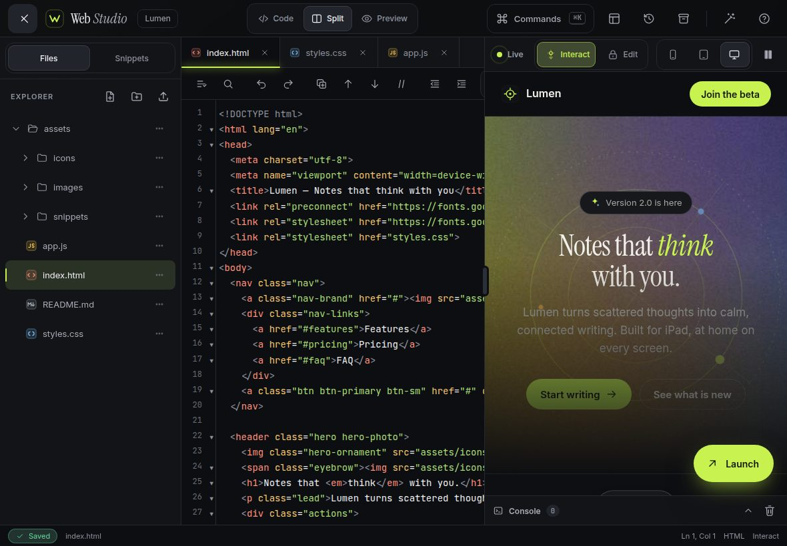
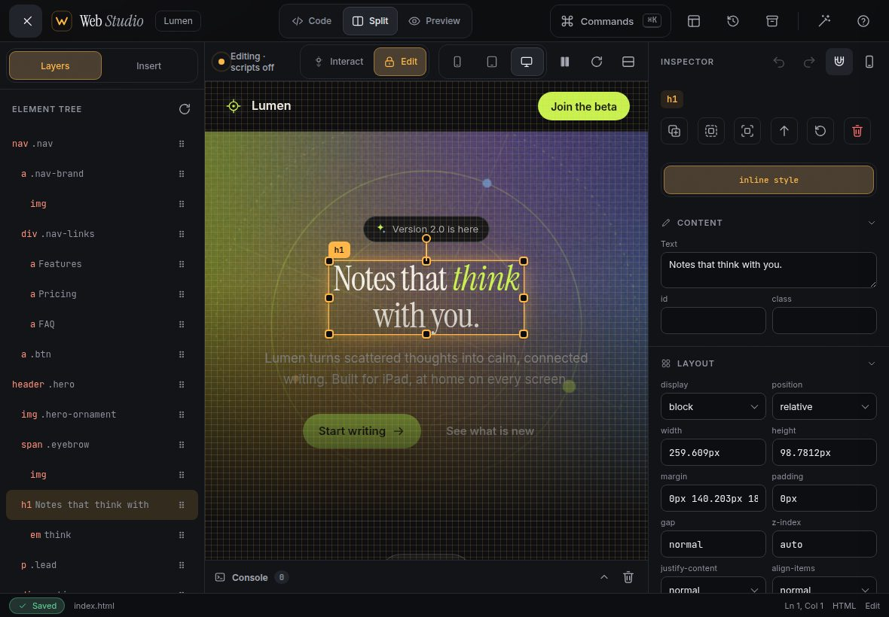
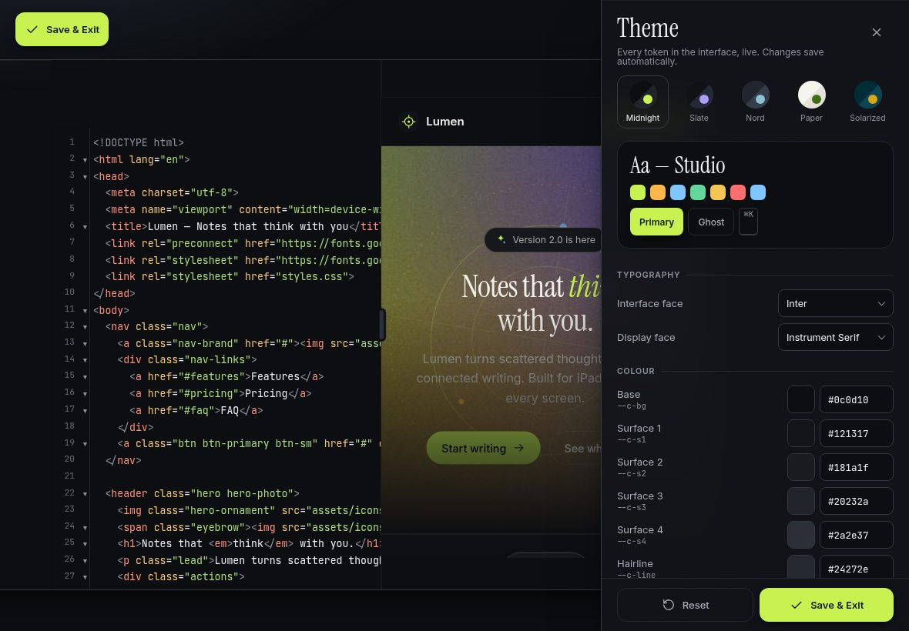

# iPad Web Studio

**A single‑file, iPad‑optimized coding IDE and visual website builder.**

One `index.html`. No build step. Open it in Safari on iPad, add it to your Home Screen, and start building.

---

## Features

**Code**
- CodeMirror 5 editor with HTML, CSS, JavaScript, JSON, SVG and Markdown modes, code folding, bracket matching, auto-close tags and active-line highlight
- Built-in Emmet abbreviation expansion on <kbd>Tab</kbd> (`ul>li.item*3`, `section.hero>h1{Hi}+p`)
- Tab bar with drag-to-reorder, rename, close, unsaved dot and an animated active underline
- File tree with nested folders, rename, duplicate, move, delete and file-type icons
- Touch toolbar: format, find & replace, duplicate line, move line, comment, indent / outdent, select all, cut, copy, paste, soft wrap, minimap
- Custom long-press context menu (Select All, Cut, Copy, Paste, Duplicate, Comment, Format)
- <kbd>⌘K</kbd> command palette with fuzzy search over every action and every file
- Snippet library: hero, feature grid, pricing card, nav, footer, modal, form, button set, toast, accordion, testimonial

**Preview**
- Live preview that updates in under 120 ms without reloading the iframe — CSS is hot-swapped in place and scroll position is preserved
- Stacked split by default in iPad portrait, side-by-side in landscape, draggable divider
- Console panel that captures `log`, `warn`, `error` and uncaught exceptions, with an error badge
- Viewport simulator (phone, tablet, full width) and pinch-to-zoom while editing
- Pause live updates, refresh, and a floating **Launch** button that opens the site in a new tab from a self-contained Blob URL

**Visual site builder**
- **Interact ⟷ Edit** toggle. In Edit, page scripts are paused and the page becomes a canvas
- Tap to select, drag to move, handles to resize and rotate, long-press for multi-select
- Snap to an 8 px grid with alignment guides, safe-area outlines, align and distribute
- Element tree with drag-to-reorder; property inspector for content, layout, typography, colour, border, effects and transforms
- Drag-to-insert palette of elements, sections and the project's own SVG icons
- Every edit is written back to source: inline `style` for one-offs, or the CSS rule in `styles.css` when you target a class. Separate visual undo / redo
- Duplicate, delete, wrap in a container, unwrap, and double-tap text to edit in place

**Design Mode**
- A theme designer for the studio itself: every colour, radius, density, type scale, shadow, blur, grain, dot-matrix and motion token, edited live
- Five presets — Midnight, Slate, Nord, Paper and Solarized — and switching animates every colour token
- Chrome mask-wipe transition, Save & Exit, Reset, and persistence across sessions

**Project & files**
- Autosave to `localStorage` with an animated “Saved” pill; IndexedDB-backed version history of up to 60 snapshots with line diffs and one-tap restore
- Import and export ZIP (JSZip, with a built-in fallback), single-file import, drag-and-drop, export the current file, copy all files, and the Web Share sheet
- Four templates: Landing, Portfolio, Blog post, Coming soon
- Installable PWA: inline manifest, generated Home Screen icon and an offline service worker

**Craft**
- 110+ hand-drawn inline SVG icons, including animated play↔pause, save→check, wand sparkle, refresh, sync orbit, chevron flip, plus→x and lock→unlock
- Spring easing, staggered reveals, skeleton shimmer on boot, and full `prefers-reduced-motion` support
- 44 pt touch targets, safe-area insets, no accidental zoom, custom scrollbars and form controls, and AA contrast in every preset

## How to use on iPad

1. Open the GitHub Pages URL for this repository in **Safari**.
2. Tap **Share → Add to Home Screen** to install it as a full-screen app. It works offline after the first visit.
3. Write code on the left (or top, in portrait). The preview updates as you type.
4. Switch the preview to **Edit** to move, resize and restyle elements with your fingers. Changes appear in your HTML and CSS.
5. Tap the wand for **Design Mode** to restyle the studio.
6. Tap **Launch** to open your site in a new tab, or use the archive button to **Export ZIP** or **Share**.

With a hardware keyboard, press <kbd>?</kbd> for the full shortcut list. Highlights: <kbd>⌘K</kbd> palette, <kbd>⌘S</kbd> snapshot, <kbd>⌘E</kbd> Interact/Edit, <kbd>⇧⌘D</kbd> Design Mode, <kbd>⌘↵</kbd> Launch, <kbd>⌘1</kbd>/<kbd>2</kbd>/<kbd>3</kbd> layouts.

Your work lives in this browser's storage. Export a ZIP regularly if it matters.

## Browser support

| Browser | Status |
| --- | --- |
| Safari on iPadOS 16.4+ | Primary target, fully supported |
| Safari on macOS 16.4+ | Supported |
| Chrome / Edge 111+ | Supported |
| Firefox 128+ | Supported (animated colour tokens fall back to instant swaps) |

The editor loads CodeMirror 5 and JSZip from cdnjs. If the CDN is unreachable, the studio boots with a built-in editor and a built-in ZIP writer, so it never fails to start.

## Architecture

Everything is in `index.html`, wrapped in one IIFE with no leaked globals. Modules:

| Module | Responsibility |
| --- | --- |
| `FileSystem` | In-memory virtual file system: text and binary files, folders, rename, move, change events |
| `Editor` | CodeMirror 5 (or textarea fallback), tabs, Emmet, formatting, toolbar and context menu |
| `Preview` | Builds the page into a `srcdoc` iframe, rewrites asset paths to Blob URLs, hot-swaps CSS, console bridge, viewport and Launch |
| `ZipIO` | ZIP import and export, single-file import, share and copy |
| `ThemeDesigner` | App design tokens, presets, Design Mode drawer and persistence |
| `VisualEditor` | Selection, handles, snapping, element tree, inspector, insert palette and write-back to HTML / CSS |
| `History` | Snapshot ring (60) in IndexedDB with line diffs |
| `CommandPalette` | Fuzzy-searchable registry of every action and file |
| `Motion` | Spring easing, tweens, staggers, reduced-motion handling |
| `UI` | Toasts, menus, modals, prompts and long-press |

`sw.js` is a small offline cache used when the browser does not allow the inline Blob service worker (Safari does not).

## GitHub Pages

This repository is set up to serve from **main / (root)**. If Pages is not enabled yet: **Settings → Pages → Source: Deploy from a branch → main / / (root) → Save**.

## License

[MIT](LICENSE)
